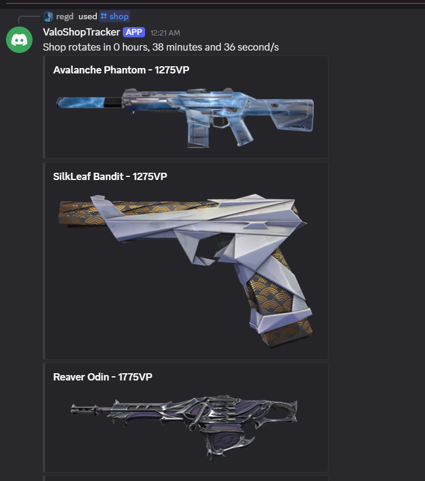

# ValoTracker (Python Version)

A Discord bot that fetches your daily Valorant shop rotation.



## How it works

Riot does not have a public supported API for fetching account details like daily shop. This bot calls community-discovered endpoints for both authentication and daily shop.

**Auth flow**:
1. **/login** generates a Riot OAuth2 authorization URL.
2. You log in through that URL, it throws a redirect error (to `localhost`), and you copy the redirected URL and paste it into the bot modal.
3. The bot extracts the authorization code and exchanges it at `auth.riotgames.com/token` for an access token & refresh token.
4. The access token is used to fetch entitlement info and player info (PUUID, shard) from Riot, which gets stored in the SQLite database.
5. From then on, the bot automatically uses the encrypted refresh token to get new access tokens when needed.

**Fetching the shop**:
The bot uses the access + entitlement tokens to hit Riot's private storefront endpoint, then resolves the returned skin IDs into readable names and images via [valorant-api.com](https://valorant-api.com).

## Security

- Refresh tokens are encrypted at rest using **AES-256-GCM** before being stored in the database (ciphertext, nonce, and auth tag stored separately).
- Access tokens are short-lived (1 hour).
- The bot never touches or stores user passwords.

## Features

- `/login [name]` - Log in with a Riot account. Generates a login link, then accepts the resulting redirect URL to complete authentication.
- `/shop` - Fetches the daily shop rotation for your **currently selected** account with images and VP costs.
- `/live [player]` - Inspects live match (In-Game or Agent Select) in real-time with high-res graphical scoreboard, party stacks, current rank, peak rank, and player highlight.
- `/view-accounts` - Lists all Riot accounts linked to your Discord account, with their IDs.
- `/account-list` - [Bot Owner Only] Lists all Riot accounts stored in the database with their Discord owners and token statuses.
- `/select-account <id>` - Switches your active/selected account (for users with multiple linked accounts).
- `/rank <player>` - Checks current rank tier, RR points, and peak rank (requires Riot ID: `Name#Tag`).
- `/lastmatch <player>` - Generates a full high-res match Scoreboard image (both teams, KDA, ACS, HS%).
- `/match <player>` - Lists the 5 most recent matches with an interactive dropdown to view full Scoreboard images.
- `/leaderboard [region] [player]` - Shows the regional competitive Radiant leaderboard (Top 15,000) with interactive pagination (AP, NA, EU, KR, BR, LATAM) or search for any player.
- `/help` - Displays the help guide and command list.

## Setup

### Requirements
- Python 3.10+
- A Discord bot application + token ([Discord Developer Portal](https://discord.com/developers/applications))

### Installation

**On Windows:**
1. Double-click `install.bat` (or run `python -m pip install -r requirements.txt` in Command Prompt / PowerShell)
2. Copy `.env.example` to `.env`
3. Generate an encryption key:
   ```cmd
   python generate_key.py
   ```
4. Fill in your `DISCORD_TOKEN`, `AES_KEY`, and `HENRIK_API_KEY` in `.env`

**On macOS / Linux:**
1. Install dependencies:
   ```bash
   pip install -r requirements.txt
   ```
2. Copy `.env.example` to `.env`:
   ```bash
   cp .env.example .env
   ```
3. Generate an encryption key:
   ```bash
   python3 generate_key.py
   ```
4. Fill in your `DISCORD_TOKEN`, `AES_KEY`, and `HENRIK_API_KEY` in `.env`

### Run

**On Windows:**
Double-click `run.bat` or run:
```cmd
python bot.py
```

**On macOS / Linux:**
```bash
python3 bot.py
```


## Important notes

- This project uses an unsupported, undocumented API. It can break at any time if Riot changes their auth flow, endpoint versions or headers.
- `X-Riot-ClientPlatform` is base64 encoded and may need updating if Riot changes client headers.
- `X-Riot-ClientVersion` is fetched dynamically from [valorant-api.com](https://valorant-api.com).
- This is an unofficial project, not affiliated with or endorsed by Riot Games.
